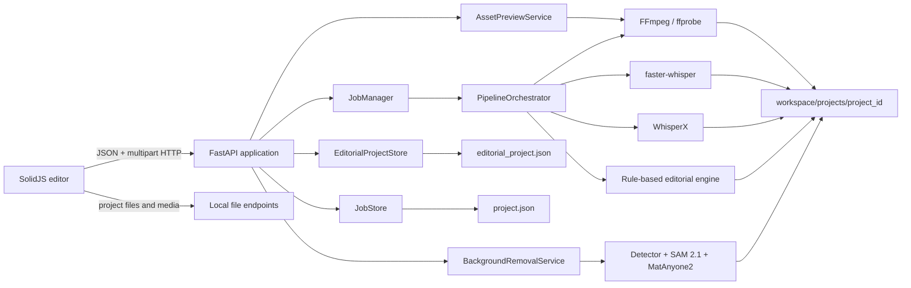
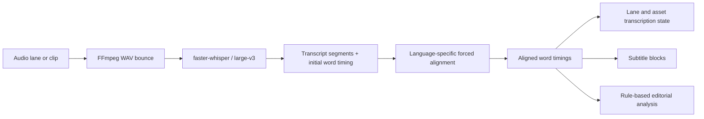
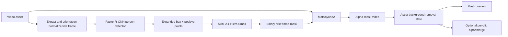

# Fellini

Fellini is a local-first, non-destructive video editor built around an editable multitrack timeline rather than an automatic end-to-end generation pipeline.

The application combines a SolidJS browser editor with a FastAPI backend, FFmpeg-based media processing, JSON project persistence, and optional local AI tools for transcription, forced alignment, editorial assistance, and video matting.

> **Project status:** Fellini is currently an early-stage local application (`0.1.0`). The editor is the primary product surface. The internal `job`, `step`, and `pipeline` abstractions exist to execute expensive tools and recover their artifacts; they are not the public editing model.

## Contents

- [What Fellini does](#what-fellini-does)
- [Technical architecture](#technical-architecture)
- [Core project model](#core-project-model)
- [Frontend architecture](#frontend-architecture)
- [Backend architecture](#backend-architecture)
- [Open models and AI components](#open-models-and-ai-components)
- [Media and render pipeline](#media-and-render-pipeline)
- [Persistence and workspace layout](#persistence-and-workspace-layout)
- [Requirements](#requirements)
- [Installation](#installation)
- [Running Fellini](#running-fellini)
- [Configuration](#configuration)
- [Local API](#local-api)
- [Development and validation](#development-and-validation)
- [Operational constraints](#operational-constraints)

## What Fellini does

Fellini provides a single editing workspace with:

- a project-based asset library for audio and video sources;
- generated filmstrips and waveform previews;
- video, audio, and subtitle lanes on a multitrack timeline;
- linked audio/video clips;
- non-destructive trim, split, slip, disable, delete, and ripple-delete operations;
- clip transforms, crop, rotation, opacity, gain, mute, and fades;
- an audio `story` lane used as the source for speech-driven tools;
- lane-level and clip-level transcription;
- generated and manually editable subtitle blocks;
- non-destructive video masks for background removal;
- editor-invoked `Editorial` and `Render` tools;
- local project export through FFmpeg.

The intended workflow is:

1. Create a project and choose the sequence canvas.
2. Upload source media into the project library.
3. Generate or inspect media previews.
4. Drag assets onto compatible timeline lanes.
5. Edit clip timing and properties without rewriting the source files.
6. Mark one audio lane as the `story` lane when speech-driven editing is needed.
7. Transcribe a lane or an individual audio clip.
8. Generate, synchronize, and edit subtitle blocks.
9. Optionally run editorial analysis or background removal.
10. Render the current timeline into the project output directory.

## Technical architecture



### Design principles

**Editor-first**  
`EditorialProject` is the source of truth for what the user sees and edits. Heavy processing exists behind tools that operate on assets, clips, lanes, the timeline, or export.

**Non-destructive**  
Timeline clips reference source assets through `source_in`, `source_out`, transforms, audio settings, and optional masks. Source media is preserved in the project workspace.

**Local-first**  
Projects, uploaded media, intermediate artifacts, model outputs, and final exports live on the local filesystem. The backend binds to `127.0.0.1` by default.

**Asynchronous where useful**  
Long-running operations use in-process daemon threads and persisted progress state. Fellini does not currently use an external queue, worker service, or database.

**Recoverable artifacts**  
Pipeline state can be reconstructed from files on disk. On backend startup, interrupted jobs and transcription states are marked as failed instead of remaining permanently `running`.

## Repository layout

```text
.
├── Agent.md                     # Canonical product framing
├── Makefile                     # Root development commands
├── shared/
│   └── workspace_layout.json    # Shared runtime filenames and directory names
├── backend/
│   ├── pyproject.toml           # Python package and Poetry dependency groups
│   ├── fellini.example.yaml     # Runtime configuration example
│   ├── scripts/                 # Model runners and platform diagnostics
│   ├── src/fellini/
│   │   ├── adapters/            # FFmpeg, ASR, alignment, subtitles, decisions
│   │   ├── domain/              # Pydantic domain models
│   │   ├── pipeline/            # Internal heavy-tool orchestration
│   │   ├── services/            # Persistence, previews, jobs, background removal
│   │   ├── app.py               # FastAPI application and local API
│   │   ├── cli.py               # `fellini serve` and `fellini run`
│   │   └── settings.py          # YAML configuration and workspace migration
│   └── tests/
├── frontend/
│   ├── package.json
│   ├── vite.config.ts
│   └── src/
│       ├── api/                  # HTTP client and Solid Query resources
│       ├── components/           # Workspace, timeline, dialogs, inspectors
│       ├── lib/editorial/        # Pure timeline and project operations
│       ├── lib/monitor/          # Demux, decode, audio transport, WebGPU render
│       ├── store.ts              # Cross-component editor state
│       └── types.ts              # Frontend representation of backend models
└── workspace/                    # Runtime-only project data
```

## Core project model

The central persisted object is `EditorialProject`.

```text
EditorialProject
├── version
├── revision
├── sequence
│   ├── width / height
│   ├── fps
│   ├── sample_rate
│   └── background
├── assets[]
├── tracks[]
├── clips[]
├── captions[]
├── asset_transcriptions[]
├── lane_transcriptions[]
├── selection
└── updated_at
```

### Assets

A `ProjectAsset` stores the library identity and probed media metadata:

- stable asset ID;
- audio or video kind;
- relative workspace path;
- duration, dimensions, FPS, sample rate, and audio presence;
- preview state for original and mask variants;
- optional background-removal state and alpha-mask path.

Preview metadata is hydrated at runtime and stripped before the core project JSON is saved. Preview generation has its own persisted state file.

### Tracks and lanes

`TimelineTrack` supports `video`, `audio`, and `subtitle` kinds. Tracks also carry ordering, visibility, mute, lock, and auto-generated flags.

Audio tracks may have one of two roles:

- `story`: the single lane used by speech-driven editorial tools;
- `support`: music, effects, ambience, or any non-primary speech lane.

The API rejects projects containing more than one story lane.

### Clips

`TimelineClip` is a non-destructive reference to an asset. Important fields include:

- timeline `start`;
- source `source_in` and `source_out`;
- `track_id` and optional linked A/V group;
- enable state and z-index;
- transform, crop, rotation, scale, position, and opacity;
- gain, mute, fade-in, and fade-out;
- optional non-destructive mask enablement;
- per-clip transcription options and status.

The backend validates that enabled clips do not overlap inside the same lane. Different lanes may overlap and are composed during preview and render.

### Subtitle blocks

`SubtitleBlock` stores editable timeline text with start/end timing and source provenance. Generated blocks can retain references to the words, source clip, source asset, and source lane from which they were produced.

### Optimistic revision control

Every project save increments `EditorialProject.revision`. A client update must submit the revision it originally loaded; stale writes receive HTTP `409` instead of silently replacing a newer project state.

## Frontend architecture

The frontend is a TypeScript application built with SolidJS and Vite.

### Main technologies

- **SolidJS** for reactive components and fine-grained state updates;
- **TanStack Solid Query** for API queries, mutations, cache invalidation, and polling;
- **WaveSurfer.js** for waveform-oriented UI;
- **Mediabunny** and browser media APIs for local monitor decoding;
- **WebCodecs** for decoded audio/video frames;
- **WebGPU** for compositing monitor video layers;
- **Tabler Icons** for the editor icon set.

### Editor state

`frontend/src/store.ts` keeps lightweight cross-component UI state such as:

- open project tabs and URL hash synchronization;
- active project ID;
- selected track, clip, and subtitle block;
- playhead and seek requests;
- play/pause and frame-step commands;
- timeline range selection and loop state;
- per-project preview/monitor paths.

The editable project itself is not treated as global UI-only state. It is loaded from and persisted to the backend through the project API.

### Browser monitor

The monitor compiles the current `EditorialProject` into a browser-side composition. Its runtime:

1. resolves active video layers at the current timeline time;
2. demuxes MP4 media and caches demux results;
3. decodes frames through browser codecs;
4. schedules timeline audio through an `AudioContext` transport;
5. composites video layers with a WebGPU renderer;
6. reports diagnostics for decode state, buffering, active layers, and errors.

The browser monitor is a responsive editing preview. Its current demux/decode path accepts MP4/MOV assets with H.264 video and AAC audio. The authoritative final export is still produced by FFmpeg on the backend.

### Development proxy

Vite runs on port `5173` and proxies `/api` and `/jobs` to the development backend on `127.0.0.1:8000`.

## Backend architecture

The backend is a Python 3.12 package exposed through FastAPI.

### Domain layer

Pydantic models define both the editor domain and the internal execution state:

- `EditorialProject`, assets, tracks, clips, captions, and transcriptions;
- `JobRequest`, `JobSnapshot`, and step status;
- transcription, subtitle, decision, and render configuration;
- media probe, transcript, EDL, caption, and render artifacts.

### Adapter layer

Adapters isolate external media and model integrations:

- `FFmpegAdapter`: probe, ingest, audio bounces, previews, timeline composition, and export;
- `FasterWhisperTranscriber`: speech-to-text through `faster-whisper`;
- `TranscriptAligner`: WhisperX forced alignment with a heuristic fallback;
- `RuleBasedDecisionEngine`: deterministic filler, repetition, pause, EDL, and caption logic;
- `LocalLLMRefiner`: reserved extension point for local LLM-based editorial refinement;
- `AssSubtitleBuilder`: ASS subtitle generation.

### Service layer

Services coordinate persistence and longer operations:

- `EditorialProjectStore`: normalization, migration, revision checks, and project saves;
- `JobStore`: project wrapper snapshots, progress, logs, and step invalidation;
- `JobManager`: synchronous or threaded tool execution;
- `AssetPreviewService`: preview state and generated filmstrip/waveform resources;
- `BackgroundRemovalService`: background-removal subprocess, progress polling, and project updates;
- `JobWorkspace`: path construction, path traversal protection, and temporary-file cleanup.

### Internal pipeline layer

`PipelineOrchestrator` remains the execution mechanism for heavy tools. Its current logical steps are:

- `ingest`;
- `transcription`;
- `editorial`;
- `render`.

An `alignment` enum still exists for internal compatibility, but alignment is normally performed as part of transcription.

Step readiness is computed from the current editor and workspace state. Examples:

- ingest requires at least one uploaded source;
- transcription requires ingested media and an audio lane;
- editorial requires a transcribed story lane;
- render requires at least one enabled clip.

Starting a heavy step marks the project wrapper as running and launches an in-process daemon thread. While a run is active, conflicting project edits, uploads, deletions, and step starts are rejected.

## Open models and AI components

Fellini uses a mixed open-source, open-weight, and source-available local model stack. The editor and FFmpeg render path work without these optional dependencies, but model-backed tools require their Poetry groups and usually download weights on first use.

> **Licensing note:** model code, model weights, and transitive alignment models have their own licenses. The table below describes the integration, not legal advice. In particular, MatAnyone2 uses the custom NTU S-Lab License 1.0 rather than a standard permissive open-source license.

| Component | Current Fellini role | Runtime status | Important implementation details |
| --- | --- | --- | --- |
| [Whisper `large-v3`](https://github.com/openai/whisper) through [faster-whisper](https://github.com/SYSTRAN/faster-whisper) | Automatic speech recognition for audio lanes and individual audio clips | Active, optional `asr` group | The default model name is `large-v3`. Fellini requests VAD filtering, beam search, language selection, and word timestamps. `faster-whisper` executes converted Whisper weights through CTranslate2. |
| [WhisperX](https://github.com/m-bain/whisperX) | Forced alignment of recognized text to the bounced audio | Active, optional `asr` group | Fellini calls `whisperx.load_align_model(language_code=...)`; the exact phoneme/CTC alignment model is selected by WhisperX for the requested language and is not pinned by Fellini. If WhisperX is unavailable and degraded mode is enabled, existing word times are retained or segment text is distributed heuristically across the segment duration. |
| Torchvision `FasterRCNN_MobileNet_V3_Large_320_FPN` | First-frame person detection for automatic mask prompting | Active, optional `vision` group | Uses the default COCO weights, filters the `person` class, selects a candidate with a size/position heuristic, expands the box, and runs on CPU by default. It only generates a prompt region; it is not the final matte model. |
| [`facebook/sam2.1-hiera-small`](https://huggingface.co/facebook/sam2.1-hiera-small) | First-frame foreground segmentation | Active, optional `vision` group | Loaded through `transformers` as `Sam2Model` and `Sam2Processor`. Fellini supplies the detector box plus three positive points around the head and torso, evaluates returned masks with a heuristic, and writes a binary first-frame mask. Device `auto` prefers MPS, then CUDA, then CPU. |
| [MatAnyone2](https://github.com/pq-yang/MatAnyone2) | Temporally consistent video alpha matting | Active, optional `vision` group | Receives the source video and the first-frame mask, propagates a matte over the sequence, and produces an alpha video. Fellini stores that alpha as an asset-level resource and applies it per clip only when `mask_enabled` is true. The upstream repository and `matanyone2.pth` checkpoint are downloaded automatically on first use when missing. |
| [`Qwen/Qwen3-8B`](https://huggingface.co/Qwen/Qwen3-8B) | Intended local editorial refinement model | Configured extension point, not currently executing inference | `DecisionConfig.local_model_name` defaults to `Qwen/Qwen3-8B`, but `LocalLLMRefiner.refine()` is currently a no-op. Current editorial decisions are deterministic and rule-based. Documentation and UI should not imply that Qwen is already rewriting or deciding edits. |

### Speech model flow



#### Whisper and faster-whisper

The default transcription configuration is:

```yaml
model: large-v3
beam_size: 5
vad_filter: true
condition_on_prev_text: false
word_timestamps: true
compute_type: int8
device: auto
```

`device: auto` currently selects CUDA only when PyTorch reports CUDA availability and the required cuDNN runtime libraries can be loaded; otherwise it falls back to CPU. Explicit CUDA requests fail with a diagnostic when the expected runtime libraries are missing.

A clip can override language, model, beam size, VAD, and WhisperX usage without changing the project-wide defaults.

#### WhisperX alignment

WhisperX is used for timing refinement, not for primary transcription. Fellini passes the recognized segment text and the bounced WAV file into WhisperX. Alignment is language-dependent; for example, WhisperX may use torchaudio pipeline bundles for several European languages and Hugging Face Wav2Vec2-family models for others.

Fellini does not currently expose WhisperX speaker diarization.

### Vision and matting flow



The default background-removal launcher currently uses:

```text
SAM 2.1 model: facebook/sam2.1-hiera-small
Person detector device: cpu
SAM device: auto
MatAnyone2 max_size: 256
MatAnyone2 warmup iterations: 1
```

The defaults prioritize a manageable local workflow over maximum matting quality. Higher internal resolution and more warmup iterations generally increase compute and memory cost; they are currently exposed by the benchmark runner rather than the main editor API.

MatAnyone2 output is stored as an alpha video, not as a destructively rewritten foreground asset. During render, Fellini combines the original video and mask with FFmpeg `alphamerge`, then applies clip opacity and the remaining timeline composition.

### AI degraded mode

`degraded_mode_when_ai_missing: true` is the default.

When optional ASR dependencies are missing:

- the editor and media library still run;
- timeline editing and FFmpeg rendering still run;
- ASR returns an empty transcript instead of terminating the whole application;
- WhisperX alignment can fall back to existing word times or heuristic distribution;
- transcript-derived editorial and subtitle behavior is limited by the missing transcript.

Vision/background-removal tools do not silently emulate the model output; they report a failed asset-processing state when their dependencies or subprocess fail.

## Media and render pipeline

### Ingest

The first uploaded source can bootstrap the editor by running ingest synchronously. Ingest probes the source and creates runtime media such as:

- a source mezzanine video;
- canonical mono 16 kHz audio;
- media probe metadata;
- an initial `EditorialProject` with source asset and timeline structures.

Additional library assets are stored without replacing the project source.

### Asset previews

Preview generation is asset-scoped and variant-aware:

- `original` preview variant;
- `mask` preview variant when an alpha mask is available;
- filmstrip image data for video;
- waveform JSON for audio.

Preview state is persisted separately from the core project so runtime status can be enriched without creating unnecessary project revisions.

### Audio bounces

Transcription operates on rendered audio, not directly on arbitrary source files.

- lane transcription mixes enabled clips on the selected audio lane into a temporary WAV;
- clip transcription renders only the selected clip range and audio settings;
- completed bounces are moved into persistent transcription directories;
- when a lane covers multiple assets, the bounce uses a lane-scoped directory;
- hard links are used where possible, with file copies as a fallback.

### Editorial analysis

The active editorial engine is deterministic. It:

- labels configured filler words;
- detects immediate repetitions inside a configurable time window;
- protects numeric tokens from unsafe automatic cuts;
- compresses or removes pauses based on soft and hard thresholds;
- builds an edit decision list with keep ranges and soft-cut metadata;
- groups retained words into subtitle chunks;
- writes intermediate JSON artifacts and a render plan.

The local LLM refiner is an extension point and currently leaves the rule-based labels unchanged.

### Final render

`FFmpegAdapter.render_project_master()` compiles the project into FFmpeg inputs and filter graphs.

The render path:

- registers each unique video, audio, and optional mask source;
- trims every clip to its source range;
- offsets clips to their timeline start;
- applies crop, scale, rotation, opacity, and translation;
- merges enabled alpha masks with their original video;
- composites video lanes over the sequence background;
- applies clip gain, mute, and fades;
- delays and mixes audio clips according to timeline position;
- writes the edited master to the project output directory.

Video encoder selection falls back from `libx264` to `libopenh264` and then `mpeg4` when the preferred encoder is unavailable in the local FFmpeg build.

## Persistence and workspace layout

Each project is stored under:

```text
workspace/projects/<project_id>/
├── project.json
├── uploads/
├── project/
│   ├── editorial_project.json
│   └── asset_previews.json
├── jobs/
│   ├── runtime/
│   │   ├── pipeline_state.json
│   │   ├── source_mezzanine.mp4
│   │   └── audio_16k_mono.wav
│   ├── previews/
│   │   └── <asset_id>/<variant>/
│   ├── transcriptions/
│   │   ├── <asset_id>/
│   │   ├── lane_<lane_id>/
│   │   └── _orphaned/
│   └── background-removal/
│       └── <asset_id>/<run_id>/
├── output/
└── temp/
```

### Important files

- `project.json`: backend wrapper state, tool progress, logs, and outputs;
- `project/editorial_project.json`: authoritative editable timeline project;
- `project/asset_previews.json`: preview generation state;
- `jobs/runtime/pipeline_state.json`: reusable internal pipeline cache;
- `jobs/runtime/source_mezzanine.mp4`: canonical ingested video;
- `jobs/runtime/audio_16k_mono.wav`: canonical transcription audio;
- `jobs/background-removal/.../progress.json`: subprocess progress;
- `jobs/background-removal/.../benchmark.json`: matting run metadata;
- `output/edited_master.mp4`: rendered project master;
- `temp/`: ephemeral scratch space cleared after operations.

### Layout migrations

Settings initialization migrates legacy runtime layouts, including:

- `workspace/jobs` to `workspace/projects`;
- project `artifacts` to `jobs`;
- `job.json` to `project.json`;
- older flat preview and transcription files into asset- and lane-scoped directories;
- legacy clip cutout state into non-destructive asset masks and `clip.mask_enabled`.

## Requirements

### Required for the base editor

- **Python 3.12.x** — the package explicitly requires `>=3.12,<3.13`;
- **Poetry**;
- **Bun** for frontend dependency management and Vite scripts;
- **FFmpeg** and **ffprobe** available on `PATH`;
- a modern Chromium-based browser with WebGPU and WebCodecs for the full monitor path;
- H.264/AAC MP4 or MOV media for the current browser monitor implementation.

### Required for optional model tools

- network access on first use to download model repositories or weights;
- **Git** for automatic MatAnyone2 checkout;
- enough local RAM/VRAM for the selected Whisper, alignment, SAM, and matting models;
- CUDA/cuDNN for the fastest supported ASR path, or CPU fallback;
- the `vision` Poetry group for detector, SAM 2.1, and MatAnyone2 integration.

Python versions outside 3.12 are intentionally unsupported by the current lock and dependency stack.

## Installation

Clone the repository and enter it, then point Poetry at Python 3.12 when necessary:

```bash
cd backend
poetry env use python3.12
cd ..
```

### Base development installation

Installs the backend, development tools, and frontend dependencies without the optional AI groups:

```bash
make setup
```

Equivalent backend-only command:

```bash
cd backend
poetry install --with dev
```

### Full local-model installation

Installs ASR, LLM extension dependencies, vision dependencies, and frontend packages:

```bash
make setup-full
```

Equivalent backend-only command:

```bash
cd backend
poetry install --with dev,asr,llm,vision
```

The Poetry virtual environment is created in `backend/.venv/` through `backend/poetry.toml`.

## Running Fellini

### Full development environment

Run the FastAPI backend on port `8000` and Vite on port `5173`:

```bash
make dev-all
```

Open:

```text
http://127.0.0.1:5173
```

### Backend only

```bash
make dev
```

or:

```bash
cd backend
poetry run fellini serve
```

The backend-only command defaults to `http://127.0.0.1:8123` and enables Uvicorn reload. It serves the compiled SPA only when `frontend/dist/index.html` exists.

Build the frontend before using the backend as a single-server application:

```bash
make fe-build
cd backend
poetry run fellini serve --no-reload
```

### One-shot CLI execution

A legacy-compatible CLI path can create a project and run its internal tools synchronously:

```bash
cd backend
poetry run fellini run /path/to/input.mp4 \
  --title "CLI project" \
  --profile balanced \
  --language it
```

For normal use, prefer the editor UI and invoke tools from the project workspace.

## Configuration

Copy the example configuration:

```bash
cp backend/fellini.example.yaml backend/fellini.yaml
```

Default configuration:

```yaml
app_name: Fellini
workspace_root: ../workspace
log_level: INFO
host: 127.0.0.1
port: 8123
ffmpeg_bin: ffmpeg
ffprobe_bin: ffprobe
fonts_dir:
recent_jobs: 12
degraded_mode_when_ai_missing: true
```

Fellini searches for configuration in this order:

1. an explicit `--config` path;
2. `backend/fellini.yaml`;
3. `fellini.yaml` in the repository root;
4. built-in defaults.

Relative paths in YAML are resolved relative to the configuration file.

## Local API

The API is intended for the local frontend. There is no built-in authentication or authorization layer, so do not expose it to an untrusted network without an authenticated reverse proxy and appropriate file-access controls.

### Project and job state

| Method | Endpoint | Purpose |
| --- | --- | --- |
| `GET` | `/api/jobs` | List recent projects and wrapper state |
| `POST` | `/api/jobs` | Create a project, optionally with multipart uploads |
| `GET` | `/api/jobs/{job_id}` | Read project wrapper, tool progress, logs, and outputs |
| `DELETE` | `/api/jobs/{job_id}` | Delete a non-running project |
| `PUT` | `/api/jobs/{job_id}/request` | Deep-merge editable execution configuration |

### Editorial project

| Method | Endpoint | Purpose |
| --- | --- | --- |
| `GET` | `/api/jobs/{job_id}/editorial-project` | Load the enriched editor project |
| `PUT` | `/api/jobs/{job_id}/editorial-project` | Validate and save a project revision |
| `POST` | `/api/jobs/{job_id}/assets` | Upload a source or library asset |
| `DELETE` | `/api/jobs/{job_id}/assets/{asset_id}` | Delete an unused library asset |
| `POST` | `/api/jobs/{job_id}/asset-previews` | Request preview generation for assets |

### Transcription and AI tools

| Method | Endpoint | Purpose |
| --- | --- | --- |
| `POST` | `/api/jobs/{job_id}/audio-lanes/{lane_id}/transcribe` | Bounce, transcribe, align, and persist an audio lane |
| `POST` | `/api/jobs/{job_id}/clips/{clip_id}/transcribe` | Transcribe one enabled audio clip with optional overrides |
| `PUT` | `/api/jobs/{job_id}/transcript` | Replace persisted raw or aligned transcript artifacts |
| `POST` | `/api/jobs/{job_id}/assets/{asset_id}/background-removal` | Start detector + SAM + MatAnyone2 processing |
| `POST` | `/api/jobs/{job_id}/steps/{step_name}/run` | Run an internal heavy tool step |

### Project files

```text
GET /jobs/{job_id}/files/{relative_path}
GET /jobs/{job_id}/files/{relative_path}?download=1
```

File resolution is constrained to the project workspace. Attempts to escape the workspace path are rejected.

## Development and validation

### Common commands

```bash
make setup
make setup-full
make install
make install-full
make dev
make dev-all
make fe-dev
make fe-build
make test
make lint
make lock
make check
make mps-test
```

### Backend checks

```bash
cd backend
poetry check
poetry run ruff check .
poetry run pytest
poetry run python -c "from fellini.app import create_app; print(create_app().title)"
```

### Frontend checks

The production build runs TypeScript project validation before Vite bundling:

```bash
cd frontend
bun run build
```

## Operational constraints

- Fellini is designed as a single-user local application, not a multi-tenant service.
- Project state is stored as JSON and media files rather than in a transactional database.
- Heavy operations run inside the backend process or a child subprocess; there is no durable external worker queue.
- A backend restart interrupts active in-process threads. Persisted artifacts are recovered where possible, and running states are converted to failures that can be retried.
- Project editing is blocked while the wrapper job is running to avoid conflicting disk writes.
- Only one audio lane may be assigned the `story` role.
- Enabled clips may not overlap within the same lane.
- Model downloads can be large and are not included in the repository.
- Exact third-party model licenses must be reviewed before redistribution or commercial deployment.
- The package metadata declares the Fellini Python package as MIT; bundled or downloaded third-party components remain under their own licenses.
